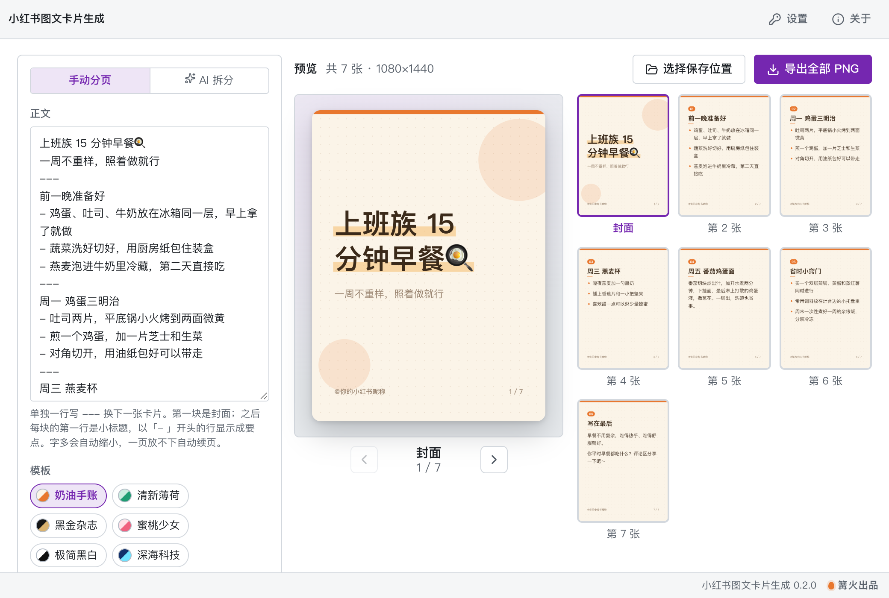

# 小红书图文卡片生成

> 篝火出品 · 收录于篝火 App 应用区

输入主题生成整套图文卡片（参考项目为非商用，代码自己写）



## 下载

到 [Releases](https://github.com/campfire-code/xhs-card-maker/releases/latest) 下载对应安装包：

| 电脑 | 文件 |
|---|---|
| Windows 10 / 11 | `xhs-card-maker_版本号_windows-x64-setup.exe` |
| Mac（Apple 芯片） | `xhs-card-maker_版本号_mac-arm64.dmg` |
| Mac（Intel 芯片） | `xhs-card-maker_版本号_mac-x64.dmg` |

第一次打开：
- **Windows**：如果弹出「Windows 已保护你的电脑」，点「更多信息」→「仍要运行」。
- **Mac**：如果提示「无法验证开发者」，打开「系统设置 → 隐私与安全性」，在下方点「仍要打开」。

## 怎么用

**不用 AI，自己分页**（不需要任何设置）：
1. 打开后左边「正文」里已经有一篇示例，直接改成你的内容，右边实时出卡片。
2. 单独一行写 `---` 表示换下一张卡片：
   - 第一块是**封面**：第一行是大标题，第二行起是副标题（可不写）；
   - 之后每块是一张**内容卡**：第一行是小标题，下面每行一段；以 `- ` 开头的行显示成带圆点的要点；
   - 整篇没有 `---` 时，第一行当封面标题，其余按空行分页。
3. 字多会自动缩小字号；最小字号也放不下时自动拆出「接上页」的续页，不会把字挤出卡片。
4. 「模板」里有 6 套风格：奶油手账、清新薄荷、黑金杂志、蜜桃少女、极简黑白、深海科技，点一下全部卡片立即换样式。
5. 「署名」会写在每张卡片左下角（如 `@你的小红书昵称`），可留空。
6. 右边中间是当前这张的大图，点右侧缩略图（或大图下方的左右箭头）切换；点大图可全屏放大，键盘左右键翻页，Esc 关闭。
7. 点「导出全部 PNG」，在保存位置下新建「小红书卡片-日期时间」文件夹，按顺序存成 `01-封面.png`、`02-小标题.png`…，每张 1080×1440（3:4 竖版），可直接发小红书。默认保存到「下载 / 小红书图文卡片生成」，点「选择保存位置」可以改。

**让 AI 拆分**（可选）：
1. 先到「设置」填自己的大模型接口地址、密钥和模型名（兼容 OpenAI 接口格式，DeepSeek、通义千问、Kimi 等都可以）。密钥只保存在这台电脑上。
2. 切到「AI 拆分」，填一个主题或贴一段正文，点「AI 拆成卡片」。
3. AI 生成封面标题、副标题和 5～8 页要点，自动填进「手动分页」，可以接着改，再导出。

**其他说明**
- 字体用电脑自带的中文字体（Mac 是苹方 / 宋体，Windows 是微软雅黑 / 宋体），不联网下载字体。不同电脑字体略有差异，换行位置可能稍有不同。
- 正文、模板、署名、保存位置会自动记住，下次打开接着用。
- 小红书一篇最多 18 张图，超过时界面会提醒。
- 除了「AI 拆分」会把你填的内容发给你自己配置的大模型，其余全部在本机完成，不上传。

## 验收用例

| 操作 | 应得到 |
|---|---|
| 把 `samples/示例-上班族早餐.txt` 的内容粘贴进「正文」（首次打开时默认就是这段） | 右边预览显示「共 7 张」：封面「上班族 15 分钟早餐🍳」+ 6 张内容卡，小标题依次是「前一晚准备好」「周一 鸡蛋三明治」「周三 燕麦杯」「周五 番茄鸡蛋面」「省时小窍门」「写在最后」 |
| 依次点 6 个模板 | 每次全部卡片都换成对应风格，文字不超出卡片 |
| 点「导出全部 PNG」 | 保存位置下出现「小红书卡片-日期时间」文件夹，内有 `01-封面.png` 到 `07-写在最后.png` 共 7 个文件，每个都是 1080×1440 的 PNG |
| 把 `samples/示例-超长正文.txt` 的内容粘贴进「正文」 | 显示「共 4 张」：封面 + 3 张「清单」卡，后两张左上角标「（接上页）」；16 条要点全部出现、每条完整在同一张卡片上 |
| 删掉所有 `---` 分隔行 | 第一行变成封面标题，其余按空行分页 |
| 没有设置大模型时，在「AI 拆分」里填「新手露营要带什么」并点「AI 拆成卡片」 | 提示「还没有设置大模型：请到「设置」里填写接口地址、密钥和模型名」，正文不变 |
| 设置好大模型后再点一次 | 「手动分页」里出现 AI 生成的封面标题和 5～8 页要点，预览同步更新 |

## 自己编译

需要 Node.js 22、pnpm、Rust。

```bash
pnpm install
pnpm test          # 单元测试
pnpm dev           # 然后打开 /selftest.html：每套模板画一遍并检查导出的 PNG（开发用）
pnpm tauri dev     # 开发运行
pnpm tauri build   # 打包
```

界面框架在 `src/kit`（所有 campfire-code 工具共用），本工具的逻辑在 `src/tool`。

## 归属

本工具由**篝火**出品，是篝火 App 应用区收录的开源工具之一，由篝火（GitHub 组织 [campfire-code](https://github.com/campfire-code)）维护与更新。全部工具的目录见 [toolkit-hub](https://github.com/campfire-code/toolkit-hub)。

## 许可证

MIT，版权方为篝火（campfire-code）。
